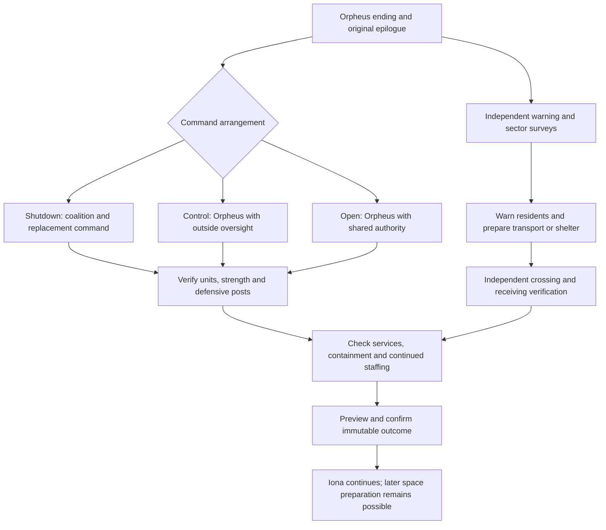

# Low Quarter defense and rescue

November 22 follow-up: a separately approved first playable response area now
uses this authority. See [LOW_QUARTER_PLAYABLE.md](LOW_QUARTER_PLAYABLE.md). The
original authority-layer scope and contracts below remain unchanged; its test
fixtures do not become production content or whole-neighborhood rescue proof.

Owner-approved design, November 21, 2026. Implementation is a mission authority,
status board, save integration and regression suite. This draft does not yet ship
an authored district operation: geography, troop strengths, schedules and named
losses must be authored before a scenario is registered in the live game.

## Approved rules

Option 3 means every Orpheus ending can save the Lower Quarter through earned
preparation. Open Network offers the strongest starting position, not an
automatic victory. Rescue results are deterministic, not random survival rolls.

Orpheus can coordinate military forces and robots. Losing that capability is a
real cost of Shutdown. The district cannot be saved solely by repairing power,
collecting records or evacuating its population. Sufficient coordinated defense
must hold the required positions while people evacuate or shelter.

| Ending | Required command arrangement |
| --- | --- |
| Shutdown | Independent military coalition; records, power, communications, staffing and tested independent command. Robots contribute only if independent operation is explicitly established. Additional military units may replace unavailable robots. Orpheus is not secretly reactivated. |
| Control | Orpheus retains centralized military and robot coordination. External stop, audit, civilian veto and a witnessed challenge to a harmful order are required. Later oversight does not rewrite the originally low-trust Control ending. |
| Open Network | Orpheus remains a coordinator under distributed authority. Earn cooperation, maintain the network, exercise local fallback and test distributed command authority. Revoking root does not delete his useful capabilities. |

Existing initial ending eligibility remains unchanged: Shutdown has no metric
gate; Control requires evidence >=70 and trust <50; Open Network requires trust
>=70, MORNINGSTAR phase 5, K personhood affirmation and Watchdog defeat. The
existing commands, achievements, consequence tokens and epilogues are preserved.
The rescue operation begins only after the existing epilogue is complete.

## Outcome contract

A full district save requires every common and branch check, every sector
surveyed and warned, all required defensive posts covered with adequate ready
strength, verified habitability and local containment, a reconciled roster,
final independent sweep, and verified safety for every discovered resident.

| Outcome | Deterministic meaning |
| --- | --- |
| district_saved | All human, service, containment, command and defensive-capacity requirements pass. |
| evacuation_only | Everyone is independently safe and the scope/count is verified, but the district-save contract fails. Report the actual territorial state; do not infer destruction from an untested defense. |
| partial_rescue | Some people are independently safe or a defended habitable sector remains, while the complete rescue contract fails. |
| rescue_failed | No verified safe people and no verified retained sector. Missing people are not automatically dead. |

Residents choose transport, shelter or refusal. Transport success requires a
present gate witness outside the vehicle crew and a receiving care handoff after
actual travel time. A refusal does not count as rescued. A sheltered resident
loses verified safety if that sector subsequently becomes uninhabitable or
uncontained. Finding an omitted resident invalidates the count and final sweep.

Vehicles and staff cannot make simultaneous trips. Vehicles must physically
return by an authored route before reuse. An interrupted trip cannot report
arrival or free its crew/vehicle without a later authored recovery operation.
A unit has one current assignment; strength does not replace coverage of a
required post. Shutdown robot deployment is rejected unless both the unit's
authored command capabilities and the independently tested-control event allow it.

## State and authority

`state.lowQuarter` is optional and additive; the campaign save key/schema is not
replaced. It records `schema`, `phase`, `scenario`, `revision`, `runId`,
`endingAtStart`, `events`, `continuationEvents` and immutable `result`.
An absent namespace remains unassessed, not success or failure. `migrate` can add
an unassessed namespace without mutating the original. Unknown future versions
and unavailable mission revisions preserve their data and block only rescue.
Existing See-world histories and Iona's standalone depot operation are untouched.
Its ledger/rescue/countWitness/allClear pattern is a model, not district proof.

`registerScenario` accepts a trusted authored definition, never a player choice.
It must supply actual sectors/posts/strengths, people, independent verifier roles,
locations, units/command modes, vehicles/routes/durations, and evidence sources
for every ending's checks. Replacing a registered revision is forbidden. No
synthetic scenario from the test suite is registered by production scripts.
The `approved` marker is an adapter declaration, not an automated canon review.

Events carry unique IDs, run/operation identity and logical ticks. Replay derives
checks, deployments, people and resource state; callers cannot grant a success
flag. Verifiers must be present in an appropriate independent role. A commander
or Orpheus cannot certify their own result. Check receipts refer to the authored
independent sources; adapters must produce these only after the actual mission
observations. This is single-player campaign state validation, not anti-cheat or
proof of an external military action.

`applyEvent` rejects invalid transitions without mutation; identical duplicate
receipts are idempotent and conflicting duplicates reject. Closeout requires an
explicit confirmation and the expected event count. Closed rescue events/results
cannot be overwritten. `transact` validates a cloned candidate and saves through
`TechOpsCampaign.save` before returning it; false/throw does not change the input.
Canonical saves validate the optional rescue state when the authority is loaded.

`applyContinuationEvent` records later space preparation after closeout without
rewriting the rescue result. Its four independently verified gates are a mission
lead, qualified ship/route, accounted crew/care and home-responsibility handoff.
Iona's AeroTech campaign stays ongoing and the wider Chorus stays active for all
outcomes. Malar remains locked pending separately authored secret boundary
conditions. District failure is neither required nor sufficient for deep space.

The read-only board is installed through the existing shared maintenance owner,
with no private timer or new storage key. It lists the ending requirements and
shows verified progress when an authored operation exists. Confirmation displays
unresolved people and missing defense requirements. Standalone scenes cannot
access or mutate the main-campaign board.

Chapter X now commits the canonical ending and its mirror together. A repeated
same selection is a no-op; conflicting selections reject. A failed save cannot
advance the ending or play its epilogue. Cache versions advance through the
entrypoint, story/presentation loader and changed late-game modules.

## Validation and remaining content

- `node test_campaign_low_quarter.js`: 58 regression cases, including all three
  full-save paths, military replacement for robots, omitted gates, scope/role
  checks, resource competition, save faults, migration and later space prep.
- `npm test`: full production gate (includes the new suite).
- `node scripts/low_quarter_browser.mjs`: real-page desktop/touch board, three
  authority contracts and reload checks. Start the existing media HTTP server on
  port 4208 or set `LOW_QUARTER_BASE_URL`. Optional
  `PLAYWRIGHT_CHROMIUM_EXECUTABLE` selects an installed browser.

Browser execution in this workspace is blocked by Chromium's process-singleton
socket restriction. Browser acceptance is pending; Node results do not establish
physical iPhone behavior or a completed playable rescue campaign.

Before enabling a live scenario, author and review the actual district map,
warning source and Chorus attack mechanism, military cooperation encounters,
independent command tests, robot-control evidence, unit strengths/locations,
transport/care schedules, local containment tests, meaningful Control challenge,
Open Network fallback, and any specific losses or deadline consequences. Recovery
from interrupted transports requires its own authored operation. No named death,
instant planetary aircraft failure, Star Hopper time travel or Malar unlock is
introduced by this implementation.

## Approved Chorus siege follow-up

The encounter layer and its current content boundary are documented in
[CHORUS_SIEGE.md](CHORUS_SIEGE.md). It adds deterministic phased arrivals,
source-bound defender assimilation, local/Sudo command separation, relay
interruption and hold verification. No live district scenario is registered.
The original civilian, military, robot, branch, persistence and continuation
contracts above remain authoritative.
