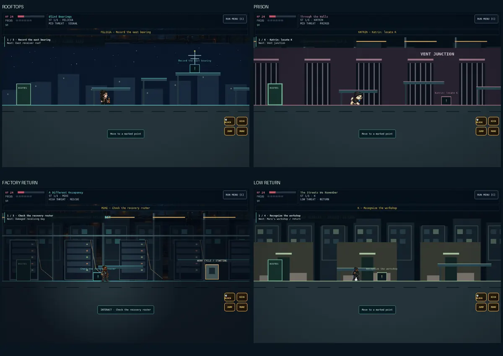

# Living World candidate evidence

The candidate has 14 completed chapters, six completed optional quests, and 121 passing production suites. The chapter playthrough used normal menus, movement, fighting, jumps, route choices, and interaction controls. It resumed its own saved checkpoints during development; it is **not** an uninterrupted run of all chapters on one frozen revision.

The final source is identified by the hashes in [receipt.json](receipt.json). The production gate, 13 domain groups, three-profile recovery checks, and final scene-render pass cover that source independently of the cumulative playthrough. The last production check includes syntax validation of 624 JavaScript files.

| Receipt | Scope |
| --- | --- |
| [playthrough.json](playthrough.json) | 14 completed chapters restored from the cumulative playthrough; six optional quests verified; zero page errors |
| [recovery.json](recovery.json) | Desktop, portrait and landscape: rollback, purchase, healing, reload, paused journal, UI bounds; actual touch movement in phone layouts |
| [scene-renders.json](scene-renders.json) | All 14 chapter views revisited through the UI from the completed playthrough, with actual room and actor recorded |
| [store-regression.json](store-regression.json) | Existing Day and Night stores on all three profiles, including field-report use and Day isolation |

Recovery uses explicit health and quota-failure fixtures. Store regression additionally uses its existing prepared Day budget, stock, and clock fixtures. No story facts or objective completion flags were injected into the authored playthrough. Browser emulation does not establish physical iOS qualification. Native story gates have domain coverage; the entire original native campaign has not been replayed for this expansion.

The phone objective card was moved clear of direction controls; the landscape interaction control was moved clear of combat buttons. At shared interaction points, the player can choose the main task or optional conversation. K's idle frame now uses a standing pose rather than a residual running frame.

The four scenes below show existing sprites with the new code-drawn environments. These are implementation visuals, not a final bespoke-art approval. In particular, the inherited K atlas still needs the current clear-glasses likeness pass. See the [expansion notes](../../LIVING_WORLD_EXPANSION.md) for that boundary and the story-source mapping.

